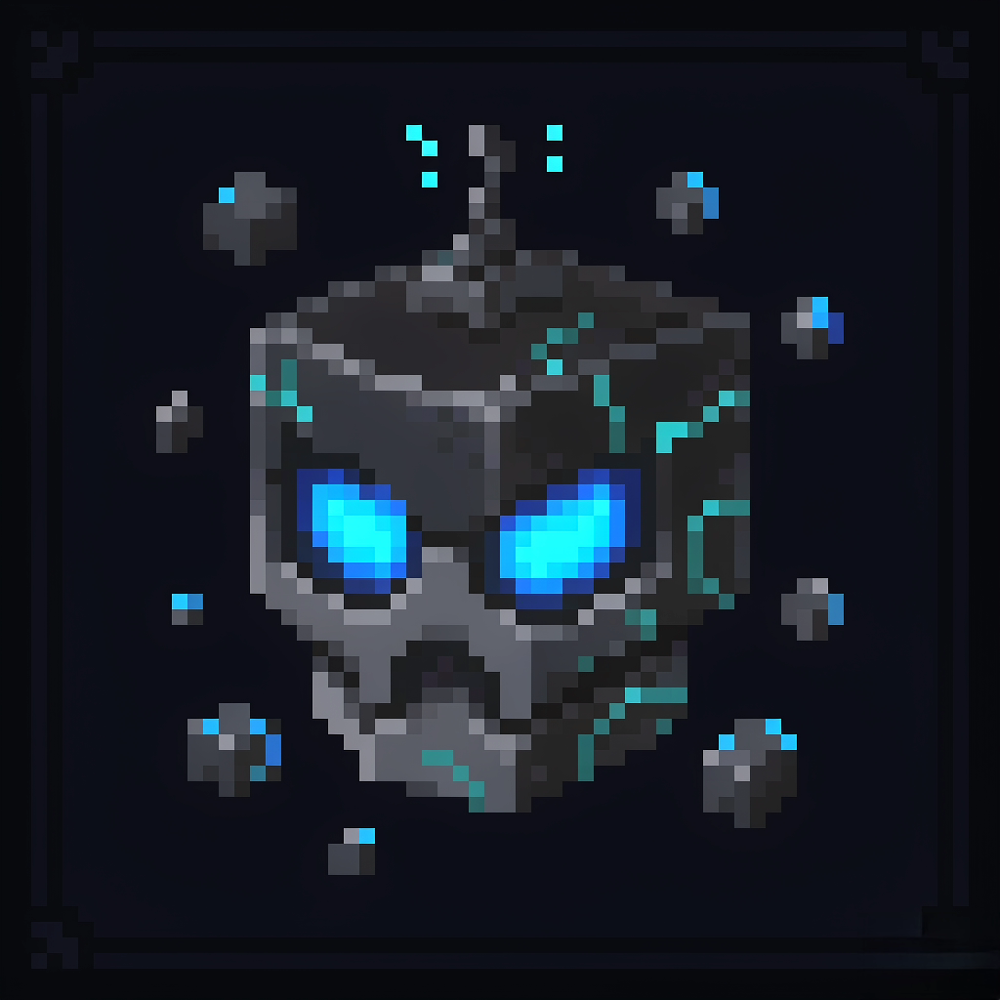

<p align="center">
  
</p>

<h1 align="center">MINECRAFT_CT_AI — Minecraft 1.16.5 Edition</h1>

<p align="center"><strong>Your AI. In Minecraft. Hands on the controls.</strong></p>

<p align="center">
  
  
  
  
  
  
</p>

> This is the **Minecraft 1.16.5 backport** of MINECRAFT_CT_AI, matching the feature set of the 1.0.2 release on modern Minecraft. It is a separate project because 1.16 uses a different toolchain and API generation.

---

## Contents

- [What it is](#what-it-is)
- [Features](#features)
- [Quick start](#quick-start)
- [First launch & setup](#first-launch--setup)
- [Commands](#commands)
- [Agent mode](#agent-mode)
- [Compatibility modes](#compatibility-modes)
- [Configuration](#configuration)
- [Project structure](#project-structure)
- [Build from source](#build-from-source)
- [1.16.5 porting notes](#165-porting-notes)
- [License & credits](#license--credits)

---

## What it is

**MINECRAFT_CT_AI** connects your own AI API (OpenAI, Anthropic, Gemini, Ollama, DeepSeek, OpenRouter, Groq, or any OpenAI-compatible endpoint) directly to Minecraft 1.16.5. You supply the provider, key, host and model; the mod gives you a chat command and an AI that can **operate the game itself**.

- **Client-side only** — no server install; works in singleplayer and on servers that allow client commands.
- **You own the AI** — no bundled service; your account, key, data and provider choice.
- **First-run setup gate** — configure bot identity and API details before the main menu.
- **Two modes in one** — plain Q&A and a whitelisted game-playing agent.

---

## Features

- **9 compatibility modes** — OpenAI Chat / Responses, Anthropic, Gemini, Ollama, DeepSeek, OpenRouter, Groq, Custom.
- **`/ctai` Q&A** — ask anything; answers print to chat, multi-line split automatically.
- **Model auto-scan** — `Scan Models` discovers all models from the host; `Models (n)` cycles them into the field.
- **Agent mode** — AI reads game context and runs whitelisted commands toward a goal you describe.
- **`/ctai_stop`** — emergency brake that interrupts the agent immediately.
- **Responsive GUI** — layout auto-fits any window size + manual UI scale (70–150%).
- **Key safety** — validation and redaction; secrets never printed to chat.
- **Test Connection** — verify host, key and model with a masked key.

---

## Quick start

**Requirements**

| Component | Version |
| :--- | :--- |
| Minecraft | Java Edition **1.16.5** |
| Java | **8 or newer** (1.16 runs on Java 8; Java 11/17 also work) |
| Fabric Loader | 0.11.3+ (0.20.1 recommended) |
| Fabric API | 0.42.0+1.16 |

**Install**

1. Install Java 8+ and Fabric Loader for Minecraft 1.16.5.
2. Put **Fabric API** (1.16 build) in your `mods` folder.
3. Put `MINECRAFT_1.16-1.0.2.jar` in the same folder.
4. Launch with the Fabric profile and complete the setup screen.

| OS | Mods folder |
| :--- | :--- |
| Windows | `%appdata%\.minecraft\mods` |
| macOS | `~/Library/Application Support/minecraft/mods` |
| Linux | `~/.minecraft/mods` |

---

## First launch & setup

The title screen is replaced by the **CREADDINSCART AI BOT** setup screen; the main menu stays locked until a valid configuration is saved.

| Field | Meaning |
| :--- | :--- |
| Bot Name | Name shown on every reply (default `CREADDINSCART AI BOT`) |
| API Key | Provider key (not needed for Ollama / Custom) |
| API Host | Base URL, e.g. `https://api.openai.com` |
| Model | Model id; blank loads the mode default |
| System Prompt | Bot behaviour instructions |
| Temperature | `0.0–2.0` (default `0.7`) |
| Max Tokens | Max answer length (default `512`) |
| Timeout (s) | Reply wait time (default `30`, min `5`) |
| Compatibility | Click to cycle the nine modes |

**Extra controls:** `Scan Models` fetch models · `Models (n)` cycle models · `Test Connection` verify · `UI xx%` scale (70–150%) · `Agent ON/OFF` toggle.

`Save & Continue` validates and stores the config. A **CT AI Setup** button remains on the title screen.

---

## Commands

| Command | Description |
| :--- | :--- |
| `/ctai <request>` | Agent ON (default): run an agent toward the request. Agent OFF: plain question. |
| `/ctai ask <question>` | One-shot answer only — never runs commands. |
| `/ctai stop` | Stop the running agent. |
| `/ctai_stop` | Quick alias for the emergency stop. |
| `/ctai test` | Test host, key and model. |

---

## Agent mode

Describe a goal in plain English:

```text
/ctai set the time to day and clear the weather
/ctai find the nearest village and tell me the coordinates
```

**Each step:** capture context (position, dimension, health, weather) → ask AI for JSON decision `{ "message", "commands", "done" }` → whitelist-check each command's first word → run approved commands via `player.chat("/...")` → repeat until done, step limit, or stopped.

**Safety defaults**

| Setting | Default |
| :--- | :--- |
| `agentEnabled` | `true` |
| `agentMaxSteps` | `12` (cap 40) |
| `agentStepDelayMs` | `1200` |
| `agentAllowedCommands` | `time, weather, locate, seed, list, say, me, tell, msg, help, gamerule, title, playsound, particle` |

---

## Compatibility modes

| Mode | Default host | Chat endpoint |
| :--- | :--- | :--- |
| OpenAI Chat Completions | `https://api.openai.com` | `/chat/completions` |
| OpenAI Responses API | `https://api.openai.com` | `/responses` |
| Anthropic Messages | `https://api.anthropic.com` | `/v1/messages` |
| Google Gemini | `https://generativelanguage.googleapis.com` | `generateContent` |
| Ollama | `http://localhost:11434` | `/api/chat` |
| DeepSeek | `https://api.deepseek.com` | `/chat/completions` |
| OpenRouter | `https://openrouter.ai/api` | `/chat/completions` |
| Groq | `https://api.groq.com/openai` | `/chat/completions` |
| Custom / OpenAI-compatible | `http://localhost:8000/v1` | `/chat/completions` |

Model scan endpoints: OpenAI-compatible → `GET /v1/models`; Ollama → `/api/tags`; Gemini → `/v1beta/models`; Anthropic → `/v1/models`.

---

## Configuration

Stored at `<minecraft config dir>/minecraft_ct_ai.json`. Delete the file to restore defaults and re-trigger setup.

```json
{
  "botName": "CREADDINSCART AI BOT",
  "apiKey": "sk-...",
  "apiHost": "https://api.openai.com",
  "compatibilityMode": "OPENAI_CHAT",
  "model": "gpt-4o-mini",
  "systemPrompt": "You are a helpful assistant inside Minecraft.",
  "temperature": 0.7,
  "maxTokens": 512,
  "timeoutSeconds": 30,
  "completed": false,
  "uiScale": 1.0,
  "availableModels": ["gpt-4o-mini", "gpt-4o"],
  "agentEnabled": true,
  "agentMaxSteps": 12,
  "agentStepDelayMs": 1200,
  "agentAllowedCommands": "time,weather,locate,seed,list,say,me,tell,msg,help,gamerule,title,playsound,particle"
}
```

> **Security:** the API key is stored in plain text in this file. Never share or commit it.

---

## Project structure

```text
MINECRAFT_1.16/
|-- build.gradle
|-- gradle.properties          minecraft 1.16.5, loom 1.19, java 8
|-- settings.gradle
|-- gradlew
|-- LICENSE
|-- MINECRAFT_1.16-1.0.2.jar
|-- branding/logo.png
`-- src/main/
    |-- java/com/creaddinscart/ctai/
    |   |-- MINECRAFT_CT_AI.java      Client entrypoint
    |   |-- CTAIConfig.java           JSON config (Java 8 I/O)
    |   |-- AiCompatibility.java      Provider enum
    |   |-- AiClient.java             HttpURLConnection HTTP + parsing + model scan
    |   |-- CTAICommand.java          ClientCommandManager registration
    |   |-- CTAIAgent.java            Agent loop + context + command guard
    |   |-- SetupScreen.java          Responsive GUI (render/PoseStack)
    |   `-- mixin/TitleScreenMixin.java
    `-- resources/
        |-- fabric.mod.json
        |-- minecraft_ct_ai.mixins.json  (JAVA_8)
        `-- assets/minecraft_ct_ai/icon.png
```

---

## Build from source

Toolchain: Minecraft 1.16.5 · Java 8 target · Gradle 9.8 · Fabric Loom 1.19 (remap) · Fabric API 0.42.0+1.16.

```bash
cd MINECRAFT_1.16
./gradlew build       # -> build/libs/MINECRAFT_1.16-1.0.2.jar
./gradlew runClient   # development client (needs a Java compatible with 1.16.5)
```

---

## 1.16.5 porting notes

This is a genuine backport, not a copy. Key differences from the modern (26.3) build:

| Area | Modern 26.3 | 1.16.5 |
| :--- | :--- | :--- |
| Java | 25 | 8 target (`--release 8`) |
| Mappings | unobfuscated Mojang | Mojang via `officialMojangMappings()` + Loom remap |
| Loom plugin | `fabric-loom` | `fabric-loom-remap` |
| HTTP client | `java.net.http` (Java 11+) | `HttpURLConnection` (Java 8) |
| Gson parse | `JsonParser.parseString()` | `new JsonParser().parse()` (Gson 2.8) |
| String blank check | `String.isBlank()` | `trim().isEmpty()` |
| File I/O | `Files.readString/writeString` | buffered Reader/Writer |
| Set screen | `minecraft.gui.setScreen()` | `minecraft.setScreen()` |
| Screen render | `extractRenderState(GuiGraphicsExtractor,…)` | `render(PoseStack,…)` + static `drawString/drawCenteredString` |
| Widgets | `addRenderableWidget()`, `Button.builder()` | `addButton()`, `new Button(x,y,w,h,…)` |
| Text | `Component.literal()` | `new TextComponent()` |
| Send command | `connection.sendCommand(cmd)` | `player.chat("/" + cmd)` |
| World access | `player.level()` | `player.level` (field) |
| Dimension key | `dimension().identifier()` | `dimension().location()` |
| Client commands | `ClientCommandRegistrationCallback` | register directly on `ClientCommandManager.DISPATCHER` (command API v1) |
| Mixin level | `JAVA_25` | `JAVA_8` |

Functionality is otherwise equivalent to the 26.3 v1.0.2 build.

---

## License & credits

Designed and developed by **CREADDINSCART**. MIT License — see [`LICENSE`](LICENSE).

This mod does not include or pay for any AI service. You provide the provider and key, and stay in full control.
