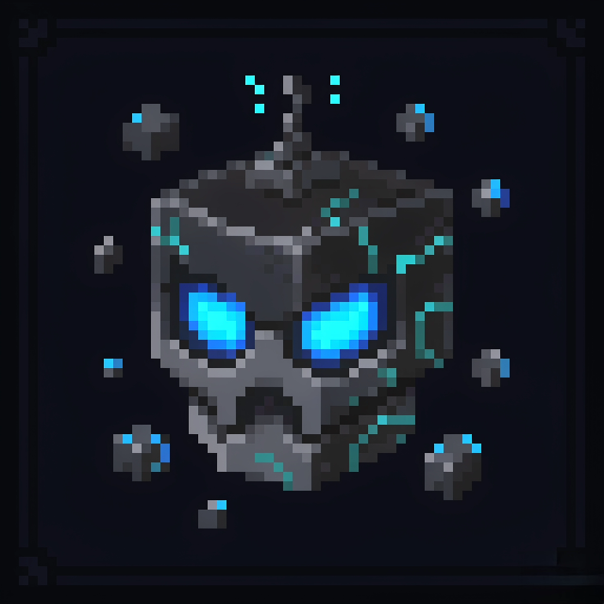

<p align="center">
  
</p>

<h1 align="center">MINECRAFT_CT_AI</h1>

<p align="center"><strong>Bring your own AI into Minecraft - Java Edition 26.1 - 26.3 (Fabric)</strong></p>

> **One line (256 chars):** MINECRAFT_CT_AI: your AI in Minecraft. 10 providers incl. one-click local model detection, setup, auto scan, /ctai Q&A, scalable GUI, safe keys, whitelisted Agent plays for you (/ctai_stop). Upcoming: SSE, vision, chat history, hotkey, TTS, Mod Menu, i18n.

| Metadata | Value |
| :--- | :--- |
| **Full project name** | MINECRAFT_CT_AI |
| **Mod ID** | `minecraft_ct_ai` |
| **Version** | 1.0.2 |
| **Game version** | Minecraft 26.1 / 26.1.1 / 26.1.2 / 26.2 / 26.3 (one JAR) |
| **Mod loader** | Fabric |
| **Environment** | Client only |
| **Language** | English |
| **License** | CREADDINSCART STUDIO terms of use + upstream MIT License |

---

## 1. INTRODUCTION

MINECRAFT_CT_AI is a client-side Fabric mod that connects your own AI API to Minecraft. You supply the provider, the API key, the host address and the model. The mod then gives you a single in-game command:

```text
/ctai <question>
```

Ask anything in chat and the answer is printed back into your chat window. The mod does not include or pay for any AI service. It uses the account and key you configure, so you stay in full control of data, cost and provider choice.

### Key points

- Runs entirely on the client. No server install is required.
- Works in singleplayer and on any multiplayer server that allows chat commands from client-side mods.
- A first-run setup screen must be completed before the game main menu is available. This guarantees the bot identity and API details are set first.
- Supports ten compatibility modes covering the most common AI APIs, including automatic detection of local model servers.
- Optional agent mode lets the AI operate the game via safe, whitelisted commands (`/ctai_stop` to stop).
- All API traffic goes directly from your game to the host you configure. Your key is stored locally on your machine only.

---

## 2. WHAT HAPPENS ON FIRST LAUNCH

When the game starts for the first time, the title screen is replaced by the **CREADDINSCART AI BOT** setup screen. You cannot reach the main menu until setup is saved. Fill in the fields in this order:

1. **Bot Name**  
   The display name for your assistant. Default: `CREADDINSCART AI BOT`. This name is shown in every chat reply.
2. **API Key**  
   Paste the secret key from your AI provider. Required for hosted modes (OpenAI, Anthropic, Gemini, OpenRouter, Groq). Not required for Ollama, Local or Custom endpoints.
3. **API Host**  
   The base URL of the provider, without a trailing path. Example: `https://api.openai.com`  
   The mod appends the correct endpoint path for the selected mode.
4. **Model**  
   The model identifier to use, e.g. `gpt-4o-mini`, `claude-3-5-haiku-latest`, `gemini-1.5-flash`, `llama3.1`. Leave it empty to load the default for the selected compatibility mode.
5. **System Prompt**  
   Instructions that define how the bot behaves. Default: `"You are a helpful assistant inside Minecraft."`
6. **Temperature**  
   Controls randomness. Range `0.0 - 2.0`. Default `0.7`.
7. **Max Tokens**  
   Maximum length of the generated answer. Default `512`.
8. **Timeout (s)**  
   Seconds to wait for a reply. Default `30`. Minimum `5`.
9. **Compatibility**  
   Click the button repeatedly to cycle through the ten supported modes. The selected mode is shown directly on the button.

**Extra controls:** `Detect Local` scans common local ports and auto-configures host/mode/model for offline local models; `Scan Models` discovers models from your host; `Models (n)` cycles through discovered models; `Test Connection` verifies host/key/model; `UI xx%` cycles interface scale (70-150%); `Agent ON/OFF` toggles agent mode. The setup screen auto-fits any window size.

Click **"Save & Continue"** to validate and store the configuration, then the game main menu opens. **"Cancel"** returns to the title screen; setup will be required again until a valid configuration is saved.

A **"CT AI Setup"** button is permanently available in the bottom-right corner of the title screen so you can reopen and edit these settings at any time.

---

## 3. USER GUIDE - HOW TO USE

### 3.1 Installation

1. Install Java 25 (required by Minecraft 26.1 - 26.3).
2. Install Fabric Loader 0.16.0 or newer for your Minecraft version.
3. Download the Fabric API build matching your Minecraft version and place it in your `mods` folder.
4. Place `MINECRAFT_CT_AI-1.0.2.jar` in the same `mods` folder — one JAR works on 26.1, 26.1.1, 26.1.2, 26.2 and 26.3.
5. Launch the game with the Fabric profile.

**Mods folder locations:**

- **Windows:** `%appdata%\.minecraft\mods`
- **macOS:** `~/Library/Application Support/minecraft/mods`
- **Linux:** `~/.minecraft/mods`

### 3.2 Asking a question

Type in chat:

```text
/ctai What is the fastest way to find diamonds?
```

The mod replies with:

```text
[CT AI] CREADDINSCART AI BOT is thinking...
[CT AI] CREADDINSCART AI BOT: <answer>
```

Questions may contain spaces. Multi-line answers are split into separate chat lines automatically.

### 3.3 Example questions

```text
/ctai Explain how redstone repeaters work
/ctai Give me a beginner-friendly base design
/ctai Translate "hello" into Japanese
/ctai Summarize the current biome I am in
```

### 3.4 Commands & Agent mode

| COMMAND | DESCRIPTION |
| :--- | :--- |
| `/ctai <request>` | With the agent ON (default), runs an AI agent that works toward your request using Minecraft commands. With it OFF, a plain question. |
| `/ctai ask <question>` | One-shot answer only, never runs commands. |
| `/ctai stop` / `/ctai_stop` | Stops a running agent immediately. |
| `/ctai test` | Tests host, key and model. |

With the agent enabled, just describe what you want:

```text
/ctai set the time to day and clear the weather
/ctai find the nearest village and tell me the coordinates
```

Each step the mod captures your position, dimension, health and weather, asks the AI for a JSON decision (message + commands + done), whitelist-checks the commands, and runs the approved ones through your client connection. The loop repeats until the task is done, the step limit (default 12) is reached, or you type `/ctai_stop`. Only command names on `agentAllowedCommands` can ever run, so world-changing commands are off by default. Use `/ctai ask` for plain question answering.

### 3.5 Compatibility modes and hosts

| MODE | DEFAULT HOST | ENDPOINT |
| :--- | :--- | :--- |
| OpenAI Chat Completions | `https://api.openai.com` | `/chat/completions` |
| OpenAI Responses API | `https://api.openai.com` | `/responses` |
| Anthropic Messages | `https://api.anthropic.com` | `/v1/messages` |
| Google Gemini | `https://generativelanguage.googleapis.com` | `/v1beta/models/...` |
| Ollama | `http://localhost:11434` | `/api/chat` |
| Local Model Server | `http://127.0.0.1:1234` | `/v1/chat/completions` |
| DeepSeek | `https://api.deepseek.com` | `/chat/completions` |
| OpenRouter | `https://openrouter.ai/api` | `/chat/completions` |
| Groq | `https://api.groq.com/openai` | `/chat/completions` |
| Custom / OpenAI-compatible | `http://localhost:8000/v1` | `/chat/completions` |

**Notes:**

- **Local Model Server** is an OpenAI-compatible offline mode. Click `Detect Local` to scan LM Studio (1234), llama.cpp / LocalAI (8080), Text Generation WebUI (5000), Ollama native (11434) and generic servers (8000); the mod auto-fills host, mode and the first model. No key or internet needed.
- Other OpenAI-compatible local servers (vLLM, KoboldCpp) can use `"Custom / OpenAI-compatible"` with their base URL.
- Gemini passes the key as a `"key"` query parameter, as required by Google.
- Anthropic sends the `x-api-key` and `anthropic-version` headers.
- OpenRouter and Groq send the standard `Authorization: Bearer` header.
- Ollama and Local need no API key and work fully offline.

### 3.6 Configuration file

Settings are stored at: `<minecraft config dir>/minecraft_ct_ai.json`

**Default config dir:**

- **Windows:** `%appdata%\.minecraft\config`
- **macOS:** `~/Library/Application Support/minecraft/config`
- **Linux:** `~/.minecraft/config`

**Example:**

```json
{
  "botName": "CREADDINSCART AI BOT",
  "apiKey": "sk-...",
  "apiHost": "https://api.openai.com",
  "compatibilityMode": "OPENAI_CHAT",
  "model": "gpt-4o-mini",
  "systemPrompt": "You are a helpful assistant inside Minecraft.",
  "temperature": 0.7,
  "maxTokens": 512,
  "timeoutSeconds": 30,
  "completed": false,
  "uiScale": 1.0,
  "availableModels": ["gpt-4o-mini", "gpt-4o"],
  "agentEnabled": true,
  "agentMaxSteps": 12,
  "agentStepDelayMs": 1200,
  "agentAllowedCommands": "time,weather,locate,seed,list,say,me,tell,msg,help,gamerule,title,playsound,particle"
}
```

**Valid values for `compatibilityMode`:** `OPENAI_CHAT`, `OPENAI_RESPONSES`, `ANTHROPIC_MESSAGES`, `GOOGLE_GEMINI`, `OLLAMA`, `LOCAL`, `DEEPSEEK`, `OPENROUTER`, `GROQ`, `CUSTOM`

Delete this file to restore defaults and trigger the setup screen again.

### 3.7 Troubleshooting

- **"Setup is not complete"**  
  Open the CT AI Setup button on the title screen and save valid settings.
- **"Request failed: HTTP 401"**  
  API key is wrong or expired.
- **"Request failed: HTTP 404"**  
  API host or model name is incorrect.
- **"Request failed: HTTP 429"**  
  Rate limit reached on your provider account.
- **"Provider returned an empty answer"**  
  The model returned no text, or the response format did not match the selected mode.
- **"Connection refused"**  
  Host is online? Check local servers and port.
- **Slow replies**  
  Lower Max Tokens, or use a faster model.

> **Security note:** your API key is stored in plain text in the local JSON file. Do not share that file or commit it to a public repository.

---

## 4. DEVELOPER DOCUMENTATION

### 4.1 Toolchain

| Tool | Version / Details |
| :--- | :--- |
| **Minecraft (build)** | 26.3 (unobfuscated Mojang names) |
| **Minecraft (runs on)** | 26.1 / 26.1.1 / 26.1.2 / 26.2 / 26.3 (single JAR) |
| **Java** | 25 |
| **Gradle** | 9.6.0 (wrapper included) |
| **Fabric Loom** | 1.17.21 |
| **Fabric Loader (build)** | 0.19.5 |
| **Fabric Loader (runtime)** | 0.16.0+ |
| **Fabric API** | 0.160.7+26.3 (compile only) |

Cross-version compatibility: every `net.minecraft` symbol referenced by the mod exists in all five supported builds. Screen transitions use the stable `Minecraft.setScreenAndShow(Screen)` API, so the same bytecode runs everywhere. `fabric.mod.json` declares `minecraft = ">=26.1 <=26.3"`.

### 4.2 Project layout

```text
MINECRAFT_CT_AI/
|-- build.gradle
|-- gradle.properties
|-- settings.gradle
|-- gradlew
|-- gradle/wrapper/
|   |-- gradle-wrapper.jar
|   `-- gradle-wrapper.properties
`-- src/main/
    |-- java/com/creaddinscart/ctai/
    |   |-- MINECRAFT_CT_AI.java      Client entrypoint
    |   |-- CTAIConfig.java           JSON config model + load/save
    |   |-- AiCompatibility.java      Provider enum and defaults
    |   |-- AiClient.java             HTTP requests + parser + model scan
    |   |-- CTAICommand.java          /ctai, /ctai_stop registration
    |   |-- CTAIAgent.java            Agent loop + context + command guard
    |   |-- SetupScreen.java          Responsive configuration GUI
    |   `-- mixin/
    |       `-- TitleScreenMixin.java Setup gate + title screen button
    `-- resources/
        |-- fabric.mod.json
        |-- minecraft_ct_ai.mixins.json
        `-- assets/minecraft_ct_ai/icon.png
```

### 4.3 Build from source

```bash
git clone <your-repo-url> MINECRAFT_CT_AI
cd MINECRAFT_CT_AI
./gradlew build
```

- **Output JAR:** `build/libs/MINECRAFT_CT_AI-1.0.2.jar`
- **Run a development client:** `./gradlew runClient`
- **Regenerate the Gradle wrapper if needed:** `gradle wrapper --gradle-version 9.6.0`

### 4.4 Runtime flow

```text
onInitializeClient()
  -> CTAIConfig.load() reads minecraft_ct_ai.json
  -> CTAICommand.register() registers /ctai via ClientCommandRegistrationCallback

TitleScreenMixin
  -> if config.completed == false, opens SetupScreen before the main menu
  -> always adds the "CT AI Setup" button to the title screen

/ctai <request>  (agent ON)
  -> CTAIAgent.start() launches a daemon agent worker
  -> each step captures game context on the client thread via Minecraft.execute()
  -> AiClient.ask() returns JSON (message, commands, done)
  -> commands are whitelist-checked and sent via player.connection.sendCommand()
  -> repeats until done, step limit, or /ctai_stop interrupts the worker

/ctai ask <question>  (or /ctai <request> with agent OFF)
  -> validates config -> daemon worker -> AiClient.ask()
  -> response parsed by AiClient.extractText() -> posted back via Minecraft.execute()
  -> answer printed to chat, one line per non-empty answer line

Scan Models -> AiClient.listModels() GETs the provider model endpoint
  -> data[].id parsed into a sorted list -> saved to config.availableModels
```

HTTP requests never run on the render thread, so the game does not freeze while waiting for an AI provider. Game-state reads and command sends are scheduled onto the client thread with `Minecraft.execute()`.

### 4.5 Adding a new compatibility mode

1. Add a constant to `AiCompatibility` with display name, default host, default model and whether an API key is required.
2. Add a case in `AiClient.buildRequest()` to construct the URL, JSON body and required headers.
3. Add a case in `AiClient.extractText()` to read the answer from the JSON response.
4. Document the mode in section 3.4 and update this file.
5. Rebuild with `./gradlew build`.

### 4.6 Important 26.x API notes (for maintainers)

- Minecraft 26.3 ships unobfuscated Mojang names. There is no Yarn mapping step in the code; imports use `net.minecraft.*` directly.
- Loom 1.17+ uses the `"net.fabricmc.fabric-loom"` plugin ID.
- Client commands use `ClientCommands.literal` / `ClientCommands.argument`, and `ClientCommandRegistrationCallback.EVENT` now has two parameters: `(dispatcher, buildContext)`.
- `FabricClientCommandSource` exposes `sendFeedback(Component)`, `sendError(Component)`, `getClient()`, `getPlayer()` and `getLevel()`.
- Screens render custom text through `extractRenderState(GuiGraphicsExtractor,...)` with `graphics.text(...)` and `graphics.centeredText(...)`.
- Screen changes use `minecraft.setScreenAndShow(...)` — the stable API present in 26.1 - 26.3 that internally maps to `Minecraft.setScreen` (26.1) or `Gui.setScreen` (26.2+). Avoid `minecraft.gui.setScreen(...)`, since the `gui` field only exists in 26.2+.
- `EditBox` uses the `(font, x, y, width, height, Component)` constructor.
- Mixin `compatibilityLevel` is `JAVA_25`.

### 4.7 Coding conventions

- All user-facing strings are English.
- No inline comments in the Java source.
- Provider calls are asynchronous; UI updates are scheduled on the client thread with `Minecraft.execute()`.
- Configuration is plain JSON via Gson, written only on explicit save.

---

## 5. PLANNED / UPCOMING FEATURES

The following are planned for future releases and are NOT part of 1.0.2.

**Shipped in 1.0.2:** responsive / manually scalable setup screen, automatic model discovery, and agent mode with `/ctai_stop`.

### 5.1 User experience

- Chat history panel with scrollback and re-ask buttons.
- Streaming replies displayed progressively in chat.
- Clickable suggested questions above the chat input.
- Per-bot aliases and multiple saved bot profiles.

### 5.2 Provider support

- Streaming SSE support for OpenAI-compatible providers.
- Vision / screenshot input: attach the current game screenshot to a question for scene-aware answers.
- Custom header editor for enterprise gateways and proxies.
- Response format templates for non-standard JSON APIs.

### 5.3 Minecraft integration

- richer agent context: biome, nearby blocks, inventory and entities.
- Agent action presets / saved task macros.
- Keybind to open a quick-ask input box.
- Optional text-to-speech for bot replies.
- Configurable chat prefix, colors and name formatting.
- Book / sign integration so answers can be written into the world.

### 5.4 Safety and controls

- Local rate limiting and per-session token budget display.
- Optional prompt allow-list and moderation filter.
- Encrypted local key storage option.
- Per-server / per-world whitelist profiles for the agent.

### 5.5 Developer tooling

- Mod Menu integration for editing settings from the Mods screen.
- Unit tests for request building and response parsing.
- Fabric API version matrix and automated build workflow.
- Public extension point so other mods can register AI providers.
- Translation files for non-English locales.

---

## 6. CREDITS

**Author:** CREADDINSCART STUDIO CREADDINSCART  
**Made with [CREADDINSCART STUDIO](https://www.shit.pub/studio/)**  
Built for Minecraft 26.1 - 26.3 and the Fabric ecosystem.  
Licensed under the CREADDINSCART STUDIO terms of use together with the upstream MIT License — see the LICENSE file in the project root.
