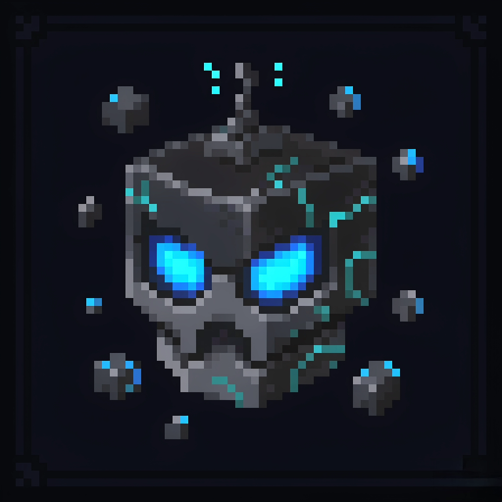
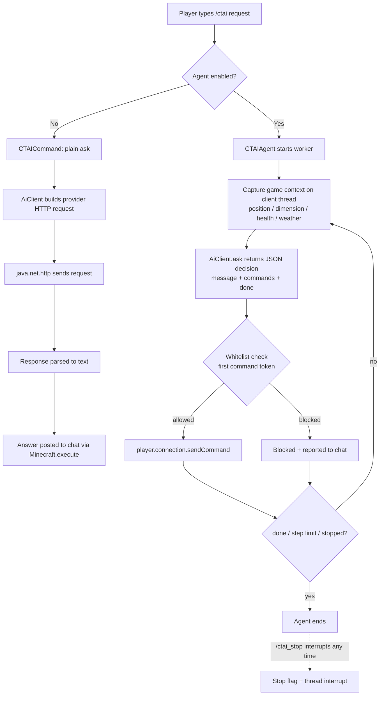

<p align="center">
  
</p>

<h1 align="center">MINECRAFT_CT_AI</h1>

<p align="center"><strong>Your AI. In Minecraft. Hands on the controls.</strong></p>

<p align="center">
  
  
  
  
  
  
</p>

<p align="center">
  A client-side Fabric mod that brings <b>your own</b> AI into Minecraft. Ask anything with <code>/ctai</code>,
  or let an AI agent play the game for you — safely, step by step, and always under your control.
</p>

---

## Contents

- [What it is](#what-it-is)
- [Why it is different](#why-it-is-different)
- [Features](#features)
- [How it works](#how-it-works)
- [Quick start](#quick-start)
- [First launch & setup](#first-launch--setup)
- [Commands](#commands)
- [Agent mode](#agent-mode)
- [Compatibility modes](#compatibility-modes)
- [Configuration](#configuration)
- [Project structure](#project-structure)
- [Developer guide](#developer-guide)
- [Roadmap](#roadmap)
- [Changelog](#changelog)
- [License & credits](#license--credits)

---

## What it is

**MINECRAFT_CT_AI** connects your own AI API (OpenAI, Anthropic, Gemini, Ollama, DeepSeek, OpenRouter, Groq, or any OpenAI-compatible endpoint) directly to Minecraft. You supply the provider, key, host and model; the mod gives you a chat command and, optionally, an AI that can **operate the game itself**.

- **Runs entirely on the client.** No server install. Works in singleplayer and on servers that allow client-side commands.
- **You own the AI.** No bundled or paid service — your account, your key, your data, your provider choice.
- **First-run setup gate.** Bot identity and API details are configured before the main menu is reachable.
- **Two modes in one mod:** plain Q&A, and an agent that plays the game through a strict command whitelist.

> MINECRAFT_CT_AI: your AI in Minecraft. 9 providers, setup, auto model scan, /ctai Q&A, scalable GUI, safe keys, whitelisted Agent plays for you (/ctai_stop). Upcoming: SSE, vision, chat history, hotkey, TTS, book/sign, Mod Menu, encryption, profiles, i18n.

---

## Why it is different

| Typical AI mod | MINECRAFT_CT_AI |
| :--- | :--- |
| Fixed, hosted AI you cannot change | Bring **your own** key and provider — 9 compatibility modes |
| Chat only | Chat **plus** an AI that operates the game in real time |
| Unbounded actions | Every agent command passes a **whitelist**; `/ctai_stop` halts instantly |
| Static GUI that breaks on scaling | **Responsive** layout + manual UI scale (70–150%) |
| Manual model typing | **Scan** every model from the host with one click |
| Secrets echoed in errors | Keys are **validated and redacted**; never printed to chat |

---

## Features

### AI & providers
- **9 compatibility modes** — OpenAI Chat, OpenAI Responses, Anthropic Messages, Google Gemini, Ollama, DeepSeek, OpenRouter, Groq, Custom / OpenAI-compatible.
- **Bring your own API** — point the mod at any host; all traffic goes straight from your game to that host.
- **Model auto-scan** — `GET <host>/v1/models` (or the Ollama/Gemini/Anthropic equivalent) discovers every available model; a button cycles them into the Model field.
- **Connection test** — verify host, key and model with a minimal request, showing only a masked key.

### Gameplay
- **`/ctai` Q&A** — ask anything; multi-line answers are split into chat lines automatically.
- **Agent mode** — the AI reads your game context and runs whitelisted commands to accomplish a goal you describe in plain English.
- **`/ctai_stop`** — an emergency brake that interrupts the agent immediately, even between steps.

### Interface & safety
- **Responsive setup screen** — fields, spacing and buttons are computed from the window size on every resize.
- **Manual UI scale** — 70 / 85 / 100 / 115 / 130 / 150%.
- **First-run gate + persistent setup button** on the title screen.
- **Key validation & redaction** — masked keys, whitespace and short keys are rejected; secrets never leak into chat.

---

## How it works



All HTTP calls run on daemon worker threads — the render thread never blocks. Game-state reads and command sends are scheduled back onto the client thread through `Minecraft.execute()`.

---

## Quick start

**Requirements**

| Component | Version |
| :--- | :--- |
| Minecraft | Java Edition 26.3 |
| Java | 25 |
| Fabric Loader | 0.19.5+ |
| Fabric API | 0.160.7+26.3 |

**Install**

1. Install Java 25 and Fabric Loader 0.19.5+ for Minecraft 26.3.
2. Put **Fabric API** in your `mods` folder.
3. Put `MINECRAFT_CT_AI-1.0.2.jar` in the same folder.
4. Launch with the Fabric profile and complete the setup screen.

| OS | Mods folder |
| :--- | :--- |
| Windows | `%appdata%\.minecraft\mods` |
| macOS | `~/Library/Application Support/minecraft/mods` |
| Linux | `~/.minecraft/mods` |

---

## First launch & setup

The title screen is replaced by the **CREADDINSCART AI BOT** setup screen; the main menu stays locked until a valid configuration is saved.

| Field | Meaning |
| :--- | :--- |
| Bot Name | Name shown on every reply (default `CREADDINSCART AI BOT`) |
| API Key | Your provider key (not needed for Ollama / Custom) |
| API Host | Provider base URL, e.g. `https://api.openai.com` |
| Model | Model id; leave blank for the mode default |
| System Prompt | Bot behaviour instructions |
| Temperature | Randomness, `0.0–2.0` (default `0.7`) |
| Max Tokens | Max answer length (default `512`) |
| Timeout (s) | Reply wait time (default `30`, min `5`) |
| Compatibility | Click to cycle the nine modes |

**Extra controls**

| Button | Action |
| :--- | :--- |
| `Scan Models` | Fetch all available models from the host |
| `Models (n)` | Cycle discovered models into the Model field |
| `Test Connection` | Verify host, key and model |
| `UI xx%` | Cycle interface scale (70–150%); layout also auto-fits |
| `Agent ON/OFF` | Enable/disable agent mode (default ON) |

`Save & Continue` validates and stores the config, then opens the main menu. A **CT AI Setup** button remains on the title screen so you can return any time.

---

## Commands

| Command | Description |
| :--- | :--- |
| `/ctai <request>` | Agent ON (default): run an agent that works toward the request. Agent OFF: plain question. |
| `/ctai ask <question>` | One-shot answer only — never runs commands. |
| `/ctai stop` | Stop the running agent. |
| `/ctai_stop` | Quick alias for the emergency stop. |
| `/ctai test` | Test host, key and model with a tiny request. |

---

## Agent mode

Describe a goal in plain English and the agent works toward it:

```text
/ctai set the time to day and clear the weather
/ctai find the nearest village and tell me the coordinates
/ctai build a small glass dome around me
```

**Each step:**
1. Capture game context on the client thread — position, dimension, health, weather.
2. Ask the AI for a JSON decision: `{ "message": "...", "commands": [...], "done": false }`.
3. Check every command's first word against the whitelist; block anything else.
4. Send approved commands via `player.connection.sendCommand()` on the game thread.
5. Repeat with a short delay until done, the step limit is hit, or you stop it.

**Stopping:** `/ctai_stop` sets the stop flag and interrupts the worker immediately.

**Safety defaults**

| Setting | Default |
| :--- | :--- |
| `agentEnabled` | `true` |
| `agentMaxSteps` | `12` (hard cap 40) |
| `agentStepDelayMs` | `1200` |
| `agentAllowedCommands` | `time, weather, locate, seed, list, say, me, tell, msg, help, gamerule, title, playsound, particle` |

Only those command names can ever run; world-changing commands are deliberately excluded. Agent quality depends on how well your model follows the JSON instruction — strong instruction-following models work best. `/ctai ask` is always available for pure Q&A.

<details>
<summary>Model scan endpoints by mode</summary>

| Mode | Model-list endpoint |
| :--- | :--- |
| OpenAI-compatible (Chat / Responses / OpenRouter / Groq / DeepSeek / Custom) | `GET <host>/v1/models` |
| Ollama | `GET <host>/api/tags` |
| Google Gemini | `GET <host>/v1beta/models` |
| Anthropic | `GET <host>/v1/models` |

</details>

---

## Compatibility modes

| Mode | Default host | Chat endpoint |
| :--- | :--- | :--- |
| OpenAI Chat Completions | `https://api.openai.com` | `/chat/completions` |
| OpenAI Responses API | `https://api.openai.com` | `/responses` |
| Anthropic Messages | `https://api.anthropic.com` | `/v1/messages` |
| Google Gemini | `https://generativelanguage.googleapis.com` | `generateContent` |
| Ollama | `http://localhost:11434` | `/api/chat` |
| DeepSeek | `https://api.deepseek.com` | `/chat/completions` |
| OpenRouter | `https://openrouter.ai/api` | `/chat/completions` |
| Groq | `https://api.groq.com/openai` | `/chat/completions` |
| Custom / OpenAI-compatible | `http://localhost:8000/v1` | `/chat/completions` |

Notes: OpenAI-compatible local servers (LM Studio, llama.cpp, vLLM, LocalAI, KoboldCpp) use **Custom** with their base URL. Gemini passes the key as a `key` query parameter. Anthropic sends `x-api-key` + `anthropic-version`. Ollama needs no key and works fully offline.

---

## Configuration

Stored at `<minecraft config dir>/minecraft_ct_ai.json` (`%appdata%\.minecraft\config` on Windows, `~/Library/Application Support/minecraft/config` on macOS, `~/.minecraft/config` on Linux). Delete the file to restore defaults and re-trigger setup.

```json
{
  "botName": "CREADDINSCART AI BOT",
  "apiKey": "sk-...",
  "apiHost": "https://api.openai.com",
  "compatibilityMode": "OPENAI_CHAT",
  "model": "gpt-4o-mini",
  "systemPrompt": "You are a helpful assistant inside Minecraft.",
  "temperature": 0.7,
  "maxTokens": 512,
  "timeoutSeconds": 30,
  "completed": false,
  "uiScale": 1.0,
  "availableModels": ["gpt-4o-mini", "gpt-4o"],
  "agentEnabled": true,
  "agentMaxSteps": 12,
  "agentStepDelayMs": 1200,
  "agentAllowedCommands": "time,weather,locate,seed,list,say,me,tell,msg,help,gamerule,title,playsound,particle"
}
```

Valid `compatibilityMode` values: `OPENAI_CHAT`, `OPENAI_RESPONSES`, `ANTHROPIC_MESSAGES`, `GOOGLE_GEMINI`, `OLLAMA`, `DEEPSEEK`, `OPENROUTER`, `GROQ`, `CUSTOM`.

> **Security:** your API key is stored in plain text in this file. Never share it or commit it to a public repository.

<details>
<summary>Troubleshooting</summary>

| Message | What to check |
| :--- | :--- |
| `Setup is not complete` | Open CT AI Setup on the title screen and save valid settings. |
| `HTTP 401` | Key wrong, expired, masked, or missing credit. |
| `HTTP 404` | Wrong host or model name. |
| `HTTP 429` | Provider rate limit / quota. |
| `Provider returned an empty answer` | Model returned no text, or response shape mismatch. |
| `Connection refused` | Local server offline or wrong port. |
| Slow replies | Lower Max Tokens or use a faster model. |

</details>

---

## Project structure

```text
MINECRAFT_CT_AI/
|-- build.gradle
|-- gradle.properties
|-- settings.gradle
|-- gradlew
`-- src/main/
    |-- java/com/creaddinscart/ctai/
    |   |-- MINECRAFT_CT_AI.java      Client entrypoint
    |   |-- CTAIConfig.java           JSON config model + load/save
    |   |-- AiCompatibility.java      Provider enum and defaults
    |   |-- AiClient.java             HTTP requests, parsing, model scan
    |   |-- CTAICommand.java          /ctai and /ctai_stop registration
    |   |-- CTAIAgent.java            Agent loop, context, command guard
    |   |-- SetupScreen.java          Responsive configuration GUI
    |   `-- mixin/TitleScreenMixin.java  Setup gate + title button
    `-- resources/
        |-- fabric.mod.json
        |-- minecraft_ct_ai.mixins.json
        `-- assets/minecraft_ct_ai/icon.png
```

---

## Developer guide

**Toolchain:** Minecraft 26.3 (unobfuscated Mojang names) · Java 25 · Gradle 9.6.0 · Fabric Loom 1.17.21 · Fabric API 0.160.7+26.3

```bash
git clone https://github.com/creaddinscart/minecraft_ct_ai.git
cd minecraft_ct_ai/MINECRAFT_CT_AI
./gradlew build       # -> build/libs/MINECRAFT_CT_AI-1.0.2.jar
./gradlew runClient   # development client
```

**Runtime flow**
- `onInitializeClient()` → `CTAIConfig.load()` → `CTAICommand.register()`
- `TitleScreenMixin` gates setup and adds the title-screen button.
- Q&A path: `CTAICommand` → `AiClient.ask()` → parse → post to chat.
- Agent path: `CTAIAgent` loop → context capture → JSON decision → whitelist → `sendCommand()`.
- Scan path: `AiClient.listModels()` → parse ids → `config.availableModels`.

**Add a compatibility mode**
1. Add a constant to `AiCompatibility` (display name, default host/model, key required).
2. Add request-building and response-parsing cases in `AiClient`.
3. Document it here and in `1.txt`, then rebuild.

**26.x API notes**
- Unobfuscated Mojang names — import `net.minecraft.*` directly.
- Client commands via `ClientCommands.literal/argument`; `ClientCommandRegistrationCallback.EVENT(dispatcher, buildContext)`.
- Screens render through `extractRenderState(GuiGraphicsExtractor, ...)`; switch with `minecraft.gui.setScreen(...)`.
- Dimension key uses `level().dimension().identifier()` (renamed from `location()`); send commands with `ClientPacketListener.sendCommand(String)`.
- Mixin `compatibilityLevel` is `JAVA_25`.

**Conventions:** all user-facing text in English · no inline comments in Java · provider calls async, UI updates on the client thread · config is Gson JSON written only on explicit save.

---

## Roadmap

Features planned for future releases (not in 1.0.2):

- **Experience** — chat history with scrollback, clickable suggested questions, per-bot profiles.
- **Providers** — SSE streaming, vision/screenshot input, custom header editor, response-format templates.
- **Minecraft** — richer agent context (biome, blocks, inventory, entities), saved task macros, quick-ask hotkey, text-to-speech, configurable chat prefix/colors, book & sign output.
- **Safety** — local rate limiting / token budget, prompt allow-list & moderation, encrypted key storage, per-world whitelist profiles.
- **Tooling** — Mod Menu integration, unit tests, automated build workflow, public provider extension point, translations (i18n).

---

## Changelog

<details open>
<summary><b>v1.0.2 — feature release</b></summary>

- Responsive setup layout + manual UI scale (70–150%).
- Automatic model discovery and model cycling.
- Agent mode with game context, command whitelist, step limit and delay.
- `/ctai_stop` and `/ctai stop`; `/ctai ask` for plain answers.
- Agent config settings and setup-screen toggle.

</details>

<details>
<summary><b>v1.0.1 — bugfix release</b></summary>

- Fixed `/v1` endpoint construction for OpenAI-compatible hosts.
- Fixed API key leakage; added redaction and friendly HTTP error guidance.
- Added key validation, Test Connection, `/ctai test`, and DeepSeek mode (9 modes total).

</details>

<details>
<summary><b>v1.0.0 — initial release</b></summary>

- First release: setup gate, `/ctai` Q&A, multi-provider support.

</details>

Full changelog: see `1.txt`.

---

## License & credits

Designed and developed by **CREADDINSCART** for Minecraft 26.3 and the Fabric ecosystem.

Released under the **MIT License** — see [`LICENSE`](LICENSE).

> This mod does not include or pay for any AI service. You provide the provider and the key, and you stay in full control of your data, cost and choices.
