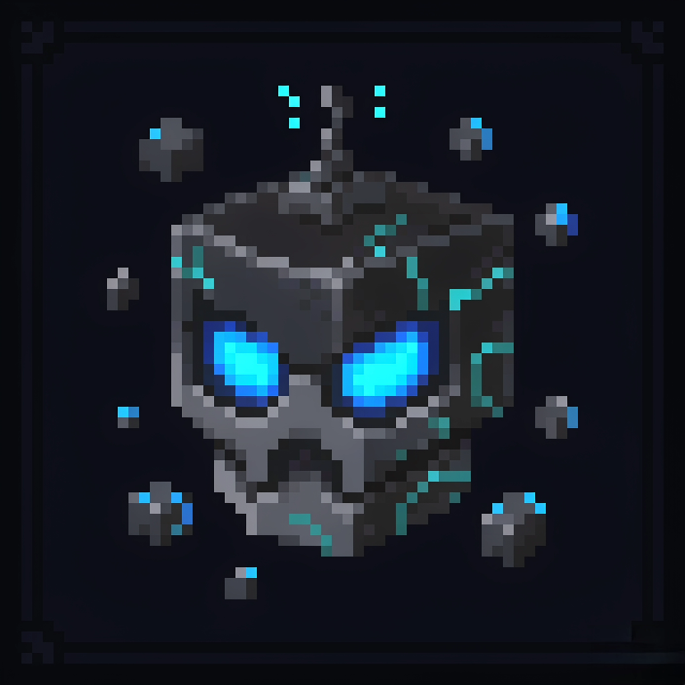

  

<h1 align="center">MINECRAFT_CT_AI — v1.0.3</h1>

<strong>One JAR. Five Minecraft versions. Your AI in the game.</strong>

---

## The release in one line

> MINECRAFT_CT_AI: your AI in Minecraft. 9 providers, setup, auto model scan, /ctai Q&A, scalable GUI, safe keys, whitelisted Agent plays for you (/ctai_stop). Upcoming: SSE, vision, chat history, hotkey, TTS, book/sign, Mod Menu, encryption, profiles, i18n.

---

## What is new in v1.0.3

**Multi-version support — one JAR, five versions.** The same `MINECRAFT_CT_AI-1.0.3.jar` now loads and runs on:

- Minecraft **26.1**
- Minecraft **26.1.1**
- Minecraft **26.1.2**
- Minecraft **26.2**
- Minecraft **26.3**

No separate downloads, no version-specific builds. Drop the one JAR into your `mods` folder and it works across the whole 26.1 - 26.3 range.

**How it works.** The code was switched to the stable `Minecraft.setScreenAndShow(Screen)` API, which exists in every supported build and internally adapts between the older `Minecraft.setScreen(...)` (26.1 series) and the newer `Gui.setScreen(...)` (26.2+). Every other `net.minecraft` symbol the mod references was verified to be present in all five builds. `fabric.mod.json` declares `minecraft = ">=26.1 <=26.3"`.

**No feature changes.** Everything from 1.0.2 — AI providers, agent mode, model scanning, responsive GUI — behaves exactly the same.

---

## What is MINECRAFT_CT_AI?

A client-side Fabric mod for **Minecraft Java 26.1 - 26.3** that connects *your own* AI API to the game. Ask anything in chat with `/ctai`, or hand the controls to an AI agent that plays the game for you — through a strict command whitelist, always under your thumb with `/ctai_stop`.

Your keys stay on your machine. Your provider is your choice. You stay in control.

---

## Highlights

- **Agent Mode** — the AI operates Minecraft for you in real time. Describe what you want in plain English; it reads your position, dimension, health and weather, then runs whitelisted commands step by step. Type `/ctai_stop` any time to take over.
- **Automatic model discovery** — the `Scan Models` button queries your provider for every available model; `Models (n)` cycles through them into the Model field. Works with OpenAI-compatible hosts, Ollama, Gemini and Anthropic.
- **Responsive setup screen** — the GUI auto-fits any window size, plus a manual `UI Scale` control (70%-150%). No more overflowing fields on large or high-DPI screens.
- **9 compatibility modes** — OpenAI Chat, OpenAI Responses, Anthropic, Gemini, Ollama, DeepSeek, OpenRouter, Groq and Custom / OpenAI-compatible.
- **More commands** — `/ctai ask <question>` for a plain answer that never touches the game, plus `/ctai stop` as an alias for the emergency brake.

---

## Full feature set (current)

| Area | What you get |
| :--- | :--- |
| Bring your own AI | Use your own API key and account — full control of data, cost and provider. |
| 9 compatibility modes | OpenAI Chat, OpenAI Responses, Anthropic, Gemini, Ollama, DeepSeek, OpenRouter, Groq, Custom / OpenAI-compatible. |
| Multi-version | One JAR runs on 26.1, 26.1.1, 26.1.2, 26.2 and 26.3. |
| First-run setup gate | Configure bot identity and API details before the main menu is reachable. |
| `/ctai` Q&A | Ask anything in chat; multi-line answers are split automatically. |
| Agent mode | AI plays the game via a whitelisted command set, with game-context awareness, a step limit and a delay between steps. |
| `/ctai_stop` | Instantly interrupt a running agent, even between steps. |
| Model auto-scan | Discover all models from your host with one click. |
| Responsive GUI | Auto-layout on any screen size + manual UI scale (70-150%). |
| Key safety | Key validation and redaction — secrets are never printed to chat. |
| Test Connection | Verify host, key and model with a minimal request. |
| Client-only | No server install; works in singleplayer and on servers that allow client commands. |

## Safety by default

The agent can **only** run commands whose first word is on a whitelist. Default allowed commands: `time, weather, locate, seed, list, say, me, tell, msg, help, gamerule, title, playsound, particle`. World-changing commands are deliberately excluded. Configure `agentEnabled`, `agentMaxSteps`, `agentStepDelayMs` and `agentAllowedCommands` in the config file, or toggle the agent in the setup screen.

---

## On the roadmap (not in this build)

SSE streaming replies, screenshot / vision input, chat history with scrollback, quick-ask hotkey, text-to-speech, book & sign integration, Mod Menu support, encrypted key storage, multiple bot profiles, and translations (i18n).

---

## Installation

1. Install **Java 25** (required by Minecraft 26.1 - 26.3).
2. Install **Fabric Loader 0.19.5+** for your Minecraft version.
3. Add the **Fabric API** build matching your Minecraft version to your `mods` folder.
4. Add `MINECRAFT_CT_AI-1.0.3.jar` to the same folder — this single JAR works on all of 26.1, 26.1.1, 26.1.2, 26.2 and 26.3.
5. Launch with the Fabric profile and complete the setup screen.

**Mods folder:** `%appdata%\.minecraft\mods` (Windows) · `~/Library/Application Support/minecraft/mods` (macOS) · `~/.minecraft/mods` (Linux)

**Requirements:** Minecraft 26.1 - 26.3 · Java 25 · Fabric Loader 0.19.5+ · Fabric API (matching build)

---

## Assets in this release

- `MINECRAFT_CT_AI-1.0.3.jar` — the mod (client, single JAR for 26.1 - 26.3)
- `MINECRAFT_CT_AI-1.0.3-sources.jar` — sources
- Full documentation: `1.txt`, `MINECRAFT_CT_AI_README.md`, `MINECRAFT_CT_AI_README_Lite.md`
- Logo: `branding/logo.png`
- License: CREADDINSCART STUDIO terms of use + upstream MIT License — see `LICENSE`
- Legal document: https://www.shit.pub/studio/

---

## Notes

- This is a **client-only** mod. It does not include or pay for any AI service; you supply the provider and key.
- Agent behaviour depends on how well your model follows the JSON instruction. Strong instruction-following models work best; `/ctai ask` is always available for plain question answering.
- Your API key is stored in plain text in the local config JSON. Do not share that file or commit it publicly.
- Older 1.0.2 builds target 26.3 only; upgrade to 1.0.3 to get the multi-version JAR.

**Full changelog and developer documentation:** see `1.txt`.

---

**Author:** CREADDINSCART STUDIO CREADDINSCART · **Made with [CREADDINSCART STUDIO](https://www.shit.pub/studio/)** · CREADDINSCART STUDIO terms + MIT License
